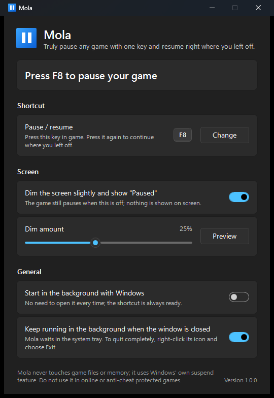
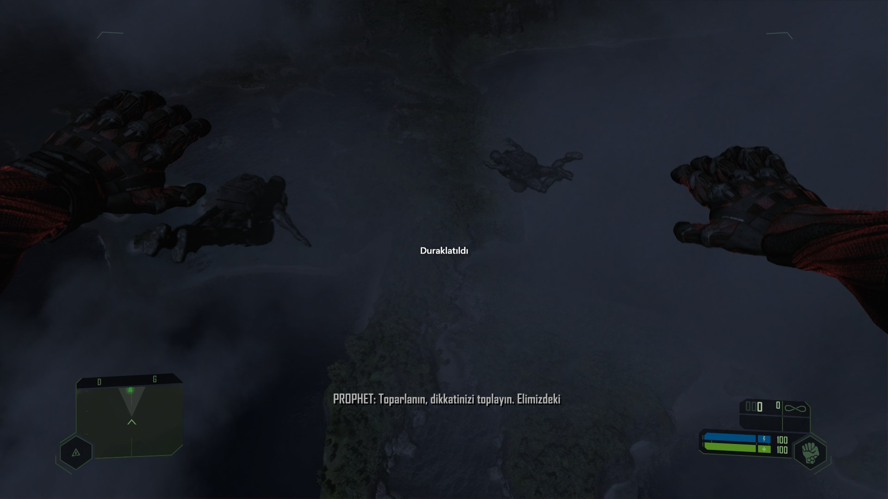

<div align="center">


# Mola

**Truly pause any PC game with one key, and resume right where you left off.**

[](https://github.com/MPolat9/Mola/releases/latest)

[](LICENSE)

**English** | [Türkçe](README.tr.md)



</div>

## Why Mola?

Many games can't be paused during cutscenes, and some can't be paused at all. Subtitles go by before you finish reading them, the doorbell rings in the middle of a scene, and the game just keeps going.

Mola freezes the game in front of you using Windows' own suspend feature. Picture, game logic and sound all stop at the same moment. Press the key again and everything continues exactly where it stopped, with sound and picture still in sync.



<sub>Crysis Remastered, paused with Mola in the middle of a cutscene. The subtitle stays on screen until you continue.</sub>

## Features

- **One key.** F8 by default. You can change it to any key or key combination.
- **A real pause.** Works in cutscenes, menus and moments the game itself won't let you pause.
- **Sound stays in sync.** Unlike "speed 0" tricks, the game's clock isn't faked, so sound doesn't drift after you resume.
- **Clear on screen.** The screen dims slightly and shows "Paused". You can adjust the amount or turn it off.
- **Alt+Tab friendly.** Switch to another window while paused and the dim layer steps aside. Go back to the game and it returns.
- **Never leaves a game frozen.** However Mola closes (exit, Windows shutdown, a crash), it releases the game first. Even if Mola is killed, the game is released the next time it starts.
- **Small and portable.** A single file of about 125 KB, nothing to install. Settings are kept in `%APPDATA%\Mola`.
- **English and Turkish.** Follows your Windows display language. Light and dark theme follow Windows too.
- **Leaves the game alone.** No file changes, no memory editing, no code injection.

## Download

1. Download **[Mola.exe](https://github.com/MPolat9/Mola/releases/latest/download/Mola.exe)** from the [latest release](https://github.com/MPolat9/Mola/releases/latest).
2. Put it anywhere you like and run it.

> **"Windows protected your PC"?**
> Mola isn't signed with a paid code signing certificate, so Windows SmartScreen may warn you the first time you run it. Click **More info**, then **Run anyway**. The full source code is in this repository if you'd like to check it or build it yourself.

## How to use

> [!IMPORTANT]
> **The game must run in Borderless or Windowed mode.** Mola does not work when the game is set to exclusive **Fullscreen**. In the game's graphics settings, set the display mode to **Borderless** (some games call it *Windowed fullscreen* or *Fullscreen windowed*). It looks the same as fullscreen.

1. Start Mola. It waits in the system tray (bottom right of the taskbar).
2. Start your game and make sure its display mode is **Borderless** or **Windowed**.
3. Press **F8** in the game to pause it. Press **F8** again to continue.

Tip: turn on **Start in the background with Windows** and the key is always ready.

## Requirements

- Windows 10 or Windows 11, 64-bit
- .NET Framework 4.8, which already comes with Windows 10 (May 2019 Update or later) and Windows 11
- The game in **Borderless** or **Windowed** mode (not exclusive Fullscreen)

## Good to know

- **Don't use Mola in online or anti-cheat protected games.** Suspending a game can look suspicious to anti-cheat software. Mola gives up politely when a game blocks it, but online games shouldn't be paused this way anyway, because the server keeps running.
- **Games running as administrator** can only be paused when Mola also runs as administrator. Mola shows a button for that when it's needed.
- **Pre-rendered video cutscenes** can briefly drop the sound right after you resume while the game's video player catches up. This comes from the game's player, not from Mola.

## FAQ

**Is it safe?**
Mola uses the same Windows feature as the "Suspend" command in Microsoft's Process Explorer. It doesn't read or change the game's memory or files, and it never connects to the internet.

**Does it work with every game?**
Single-player games running in Borderless or Windowed mode should work. It has been tested with Call of Duty: Modern Warfare Remastered and Crysis Remastered. It does not work in exclusive Fullscreen mode. Games protected by anti-cheat refuse, and Mola doesn't try to force them.

**Where are my settings?**
In `%APPDATA%\Mola\ayarlar.ini`. Delete that folder to reset everything. A small log file (`mola.log`) is kept there too, which helps when reporting a problem.

**How do I remove it?**
Turn off "Start in the background with Windows" if you turned it on, choose Exit from the tray icon's menu, then delete `Mola.exe` and the `%APPDATA%\Mola` folder.

## Build from source

You need Windows and the [.NET SDK](https://dotnet.microsoft.com/download) (version 6 or later).

```powershell
git clone https://github.com/MPolat9/Mola.git
cd Mola
powershell -ExecutionPolicy Bypass -File araclar\derle.ps1
```

The program is built to `derleme\Mola.exe`. The build is reproducible: building a release tag gives exactly the same file as the `Mola.exe` in that release, so you can compare the SHA-256 shown in the release notes with `Get-FileHash derleme\Mola.exe`.

Developer notes (in Turkish) are in [docs/GELISTIRME.md](docs/GELISTIRME.md).

## How it works

1. The shortcut is registered system wide with `RegisterHotKey`, so the key press never reaches the game.
2. Mola finds the process that owns the window in front. Windows' own processes (Explorer, DWM and others) are skipped.
3. The process is suspended with `NtSuspendProcess` and later resumed with `NtResumeProcess`. All of its threads stop together, including audio.
4. A transparent layer that never takes focus covers the game's monitor, dims it and shows "Paused". It also catches mouse clicks so they don't pile up for the frozen game.
5. The frozen process (its ID and start time) is written to disk before it is suspended. If Mola ends unexpectedly, the game is released on the next start.

## Reporting a problem

Open an [issue](https://github.com/MPolat9/Mola/issues) and include your Windows version, the game, and what happened. Attaching `%APPDATA%\Mola\mola.log` helps a lot.

## About

Made by [MPolat](https://mpolat.pro).

Released under the [MIT License](LICENSE).
