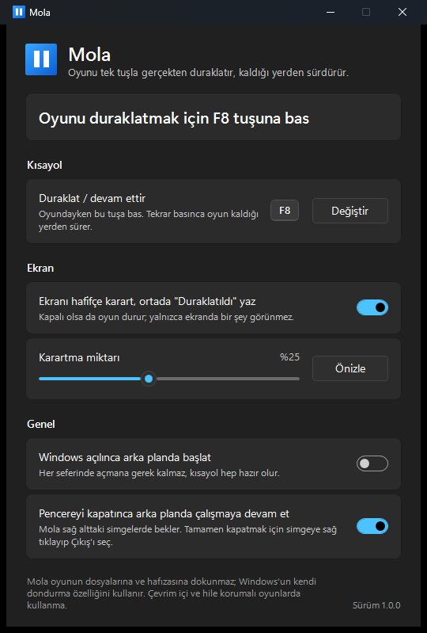

<div align="center">


# Mola

**Bilgisayar oyunlarını tek tuşla gerçekten duraklatır, kaldığı yerden sürdürür.**

[](https://github.com/MPolat9/Mola/releases/latest)

[](LICENSE)

[English](README.md) | **Türkçe**



</div>

## Neden Mola?

Birçok oyun ara sahnelerde duraklatılamaz, bazıları hiç duraklatılamaz. Altyazıyı okumayı bitirmeden sahne geçer, sahnenin ortasında kapı çalar, oyun akmaya devam eder.

Mola, öndeki oyunu Windows'un kendi dondurma özelliğiyle durdurur. Görüntü, oyunun işleyişi ve ses aynı anda durur. Tuşa tekrar basınca her şey tam kaldığı yerden sürer, ses ile görüntü birbirinden kaymaz.


<sub>Crysis Remastered, ara sahnenin ortasında Mola ile duraklatıldı. Altyazı, devam edene kadar ekranda kalır.</sub>

## Özellikler

- **Tek tuş.** Varsayılan F8. İstediğin tuşla ya da tuş birleşimiyle değiştirebilirsin.
- **Gerçek duraklatma.** Ara sahnelerde, menülerde ve oyunun kendisinin durdurmana izin vermediği anlarda da çalışır.
- **Ses kaymaz.** "Hız 0" hilelerinin aksine oyunun saati kandırılmaz, bu yüzden devam edince ses geride kalmaz.
- **Ekranda belli olur.** Ekran hafifçe kararır, ortada "Duraklatıldı" yazar. Karartma miktarını ayarlayabilir ya da kapatabilirsin.
- **Alt+Tab ile uyumlu.** Duraklatmışken başka pencereye geçersen karartma çekilir, oyuna dönünce geri gelir.
- **Oyunu asla donuk bırakmaz.** Mola nasıl kapanırsa kapansın (çıkış, Windows kapanışı, hata) önce oyunu çözer. Zorla kapatılsa bile bir sonraki açılışta oyunu serbest bırakır.
- **Küçük ve taşınabilir.** Yaklaşık 125 KB'lık tek dosya, kurulum yok. Ayarlar `%APPDATA%\Mola` içinde durur.
- **Türkçe ve İngilizce.** Windows'un görüntüleme diline göre açılır. Açık ve koyu tema da Windows'a uyar.
- **Oyuna dokunmaz.** Oyunun dosyası değişmez, hafızasıyla oynanmaz, oyuna kod sokulmaz.

## İndir

1. **[Mola.exe](https://github.com/MPolat9/Mola/releases/latest/download/Mola.exe)** dosyasını [son sürüm](https://github.com/MPolat9/Mola/releases/latest) sayfasından indir.
2. İstediğin klasöre koy ve çalıştır.

> **"Windows bilgisayarınızı korudu" uyarısı mı çıktı?**
> Mola ücretli bir kod imzalama sertifikasıyla imzalanmadığı için Windows SmartScreen ilk açılışta uyarı verebilir. **Ek bilgi**'ye, ardından **Yine de çalıştır**'a tıkla. Kodun tamamı bu sayfada, istersen inceleyebilir ya da kendin derleyebilirsin.

## Kullanım

> [!IMPORTANT]
> **Oyun Çerçevesiz ya da Pencere modunda olmalı.** Oyunun görüntü modu **Tam ekran** iken Mola çalışmaz. Oyunun grafik ayarlarından görüntü modunu **Çerçevesiz** yap (bazı oyunlarda *Kenarlıksız* ya da *Pencereli tam ekran* diye geçer). Görünüşü tam ekranla aynıdır.

1. Mola'yı aç. Görev çubuğunun sağ altındaki simgelerde bekler.
2. Oyununu aç ve görüntü modunun **Çerçevesiz** ya da **Pencere** olduğundan emin ol.
3. Oyundayken **F8**'e bas, oyun durur. Tekrar **F8**'e bas, kaldığı yerden devam eder.

İpucu: **Windows açılınca arka planda başlat** seçeneğini açarsan kısayol her zaman hazır olur.

## Gereksinimler

- Windows 10 ya da Windows 11, 64 bit
- .NET Framework 4.8. Windows 10 (Mayıs 2019 güncellemesi ve sonrası) ve Windows 11 ile zaten hazır gelir.
- Oyunun **Çerçevesiz** ya da **Pencere** modunda çalışması (Tam ekran değil)

## Bilmen gerekenler

- **Mola'yı çevrim içi ya da hile korumalı oyunlarda kullanma.** Oyunu dondurmak, hile koruma yazılımlarına şüpheli görünebilir. Bir oyun engellerse Mola zorlamaz, uyarıp çekilir. Zaten çevrim içi oyunlar bu şekilde durdurulmamalı, çünkü sunucu çalışmaya devam eder.
- **Yönetici olarak çalışan oyunlar**, ancak Mola da yönetici olarak açılırsa duraklatılabilir. Gerektiğinde Mola bunun için bir düğme gösterir.
- **Önceden kaydedilmiş video ara sahnelerinde** devam ettirince ses bir anlığına kesilip gelebilir. Bunu oyunun video oynatıcısı yapar, Mola değil.

## Sık sorulanlar

**Güvenli mi?**
Mola, Microsoft'un Process Explorer programındaki "Suspend" (askıya al) komutuyla aynı Windows özelliğini kullanır. Oyunun hafızasını ya da dosyalarını okumaz, değiştirmez ve internete hiç bağlanmaz.

**Her oyunda çalışır mı?**
Çerçevesiz ya da Pencere modunda çalışan tek oyunculu oyunlarda çalışması gerekir. Call of Duty: Modern Warfare Remastered ve Crysis Remastered ile denendi. Tam ekran modunda çalışmaz. Hile korumalı oyunlar izin vermez, Mola da zorlamaz.

**Ayarlarım nerede?**
`%APPDATA%\Mola\ayarlar.ini` dosyasında. Her şeyi sıfırlamak için bu klasörü silebilirsin. Aynı yerde küçük bir günlük dosyası (`mola.log`) da durur, sorun bildirirken çok işe yarar.

**Nasıl kaldırırım?**
"Windows açılınca arka planda başlat" seçeneğini açtıysan kapat, simgenin menüsünden Çıkış'ı seç, sonra `Mola.exe` dosyasını ve `%APPDATA%\Mola` klasörünü sil.

## Kaynaktan derleme

Windows ve [.NET SDK](https://dotnet.microsoft.com/download) (6 ya da üstü) gerekir.

```powershell
git clone https://github.com/MPolat9/Mola.git
cd Mola
powershell -ExecutionPolicy Bypass -File araclar\derle.ps1
```

Program `derleme\Mola.exe` olarak çıkar. Derleme her yerde aynı sonucu verir: bir sürüm etiketinden derlediğin dosya, o sürümdeki `Mola.exe` ile birebir aynıdır. Sürüm notlarındaki SHA-256 değerini `Get-FileHash derleme\Mola.exe` ile karşılaştırabilirsin.

Geliştirici notları: [docs/GELISTIRME.md](docs/GELISTIRME.md).

## Nasıl çalışır

1. Kısayol `RegisterHotKey` ile Windows'a sistem genelinde kaydedilir, böylece tuş oyuna hiç ulaşmaz.
2. Mola o an öndeki pencerenin ait olduğu programı bulur. Windows'un kendi parçaları (Explorer, DWM ve diğerleri) atlanır.
3. Oyun `NtSuspendProcess` ile dondurulur, `NtResumeProcess` ile çözülür. Ses dahil bütün iş parçacıkları birlikte durur.
4. Odak almayan şeffaf bir katman oyunun ekranını kaplar, karartır ve "Duraklatıldı" yazar. Fare tıklamalarını da kendisi tutar ki donuk oyunda birikmesin.
5. Donan oyunun bilgisi (işlem numarası ve başlama zamanı) dondurmadan önce diske yazılır. Mola beklenmedik şekilde kapanırsa oyun bir sonraki açılışta çözülür.

## Sorun bildirme

Bir [issue](https://github.com/MPolat9/Mola/issues) aç; Windows sürümünü, oyunu ve ne olduğunu yaz. `%APPDATA%\Mola\mola.log` dosyasını eklersen çok yardımcı olur.

## Hakkında

[MPolat](https://mpolat.pro) tarafından yapıldı.

[MIT Lisansı](LICENSE) ile yayımlanmıştır.
